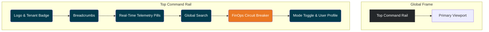

Of course. Here is the publication-grade UX/UI Conceptual Design Blueprint for the Huntington Ingalls Industries (HII) Multi-Audience Sentiment Intelligence & Forecasting Platform.

***

# HII SENTINEL: Conceptual Design Blueprint
## Multi-Audience Sentiment Intelligence & Forecasting Platform

**Version:** 1.0 | **Status:** Conceptual | **Author:** Executive UX Architect & Principal Design Director

This document outlines the conceptual user experience and interface architecture for **HII SENTINEL**, a decision-support platform designed to provide Huntington Ingalls Industries and its key stakeholders with a unified, auditable, and predictive view of multi-audience sentiment and its impact on strategic objectives.

---

## 1. Design Philosophy & Visual Language

HII SENTINEL is not a dashboard; it is a strategic instrument. Its design must embody precision, authority, and unassailable trust. The aesthetic is inspired by naval command centers and aerospace flight decks—environments where information density is high, clarity is paramount, and every pixel serves a purpose.

### Color Palette
The palette is chosen for its professional tone, accessibility, and thematic resonance with the maritime and defense domain.

*   `#24272a` **Charcoal Slate**: Primary background for dark mode. Evokes the hull of a submarine or the seriousness of a command center.
*   `#003b4d` **Deep Sea**: Primary accent and container background. A rich, corporate blue-teal that suggests depth and stability.
*   `#509ca2` **Changing Sea**: Primary interactive color for highlights, selections, and active states. Represents dynamism and forward momentum.
*   `#75abd1` **Sky Blue**: Used for positive sentiment lift, forecast confidence corridors, and informational callouts.
*   `#ea7722` **Passion Orange**: The sole high-energy accent. Reserved exclusively for critical alerts, negative sentiment drag, forecast risks, and calls to immediate attention.
*   `#f0f4f8` **Deck Gray**: Primary background for the sunlight-readable high-contrast mode.

### Typography Hierarchy
A combination of a monospaced font for data and a sans-serif for readability ensures clarity at every level of information density.

*   **Data & Telemetry:** `JetBrains Mono`
    *   **Why:** Excellent legibility of numbers, symbols, and identifiers. Its fixed width ensures that tabular data, timelines, and cryptographic hashes align perfectly, reinforcing the platform's deterministic nature.
*   **Interface & Readouts:** `Inter` or `Geist Sans`
    *   **Why:** Modern, highly legible sans-serif fonts that are clear at small sizes for UI labels and scale gracefully for executive briefing headlines.

### Information Density & Modes
The platform operates in two primary contexts, supported by two visual modes.

1.  **Command Center Mode (Dark Slate)**: The default experience. Optimized for extended use in controlled lighting environments (offices, SCIFs, command centers). High-contrast text on dark backgrounds reduces eye strain and allows color accents to stand out for rapid cognitive processing.
2.  **Executive Briefing Mode (Sunlight Readable)**: A high-contrast light theme (`Deck Gray` background). Optimized for presentation on projectors in bright conference rooms or for quick glances on a mobile device outdoors. Toggled via a single icon in the command rail.

---

## 2. Global Navigation & Layout Wireframe

The layout is a persistent, single-page application (SPA) frame that provides constant context and immediate access to core functions.

*   **Top Command Rail (48px height)**:
    *   **HII Logo & Tenant Badge**: `[ HII SENTINEL | Tenant: PEO CARRIERS ]` clearly identifies the instance.
    *   **Breadcrumbs**: `Executive Glance / > Multi-Audience Timeline / > CVN 79 Elevator Analysis` allows for instant orientation and one-click navigation up the hierarchy.
    *   **Real-Time Telemetry Pills**: `[ Last Sweep: 2h ago ]` `[ Forecast Model: v3.1.2-alpha ]` `[ Ledger Events: 159 ]`. These are not just labels; they are trust indicators.
    *   **Global Search (Cmd+K)**: A powerful search bar to find any program, event, or source document.
    *   **FinOps Circuit Breaker**: A visual gauge showing the monthly research agent budget (`$3.75 / $5.00`). Turns `Passion Orange` when approaching the limit. Clicking reveals usage details.
    *   **Mode & User Controls**: Icons for toggling Light/Dark mode, accessing the Access Request Queue (for admins), and User Profile/Logout with Google OAuth branding.

---

## 3. Primary Experience Layers (Screens & Views)

The platform is architected as a series of cascading layers, allowing users to drill down from a 30,000-foot executive summary to cryptographic proof-of-work.

### Layer 1: The Executive 30-Second Glance

*   **Purpose**: Answer "How are we doing?" and "What should I worry about?" in under 30 seconds.
*   **Layout**: A 2x2 grid of high-level modules.
    1.  **Composite Sentiment KPI**: A single, large number (e.g., `+7.2`) with a trailing 30-day sparkline. The number represents the weighted-average sentiment score across all audiences. Color-coded `Sky Blue` for positive, `Passion Orange` for negative.
    2.  **Audience Pulse Delta**: A bar chart showing the 30-day change in sentiment for each core audience (Congress, DoD, Navy, Markets). Highlights the most significant mover. `[ CONGRESS: +3.1 ▲ | MARKETS: -1.8 ▼ ]`
    3.  **6-Month Forecast Trajectory**: A simplified line chart showing the composite sentiment's forward projection, wrapped in the P10/P90 `Sky Blue` confidence fan. Key inflection points are marked.
    4.  **Top Catalyst Alert**: A single card detailing the #1 event driving the current sentiment delta or forecast. `[ ALERT: GAO REPORT ON CVN 79 ELEVATOR RELIABILITY | IMPACT: -2.5 DRAG ON NAVY SENTIMENT ]`. This is a direct link to Layer 3.

### Layer 2: The Multi-Audience Timeline & Presentation Canvas

*   **Purpose**: Explore the "Why" behind the numbers over time. Build a narrative for presentation.
*   **Layout**:
    *   **Main View**: An interactive longitudinal timeline (2011-2026+). The X-axis dynamically changes fidelity as the user zooms (Annual -> Quarterly -> Monthly). A vertical "Today" line is prominently featured.
    *   **Swimlanes**: Separate horizontal lanes for each Audience (Congress, DoD, etc.) show their individual sentiment scores over time.
    *   **Confidence Corridor**: The 6-month forecast extends from the "Today" line, visually distinct with its `Sky Blue` confidence fan.
    *   **Interactive Scrubber**: A handle that the user can drag across the timeline. As it moves, all data on the screen filters to that point in time.
    *   **Pinned Presentation Rack**: A fixed rail on the right side of the screen. Users can "star" key events on the timeline (e.g., "BCA Sequestration," "2-Carrier Contract Award"). These events populate the rack as clean, presentation-ready callout cards, which can be reordered and exported as a slide deck or PDF.

### Layer 3: Division & Program Attribution Studio

*   **Purpose**: Decompose macro-sentiment into its constituent parts. Attribute lift and drag to specific business units and programs.
*   **Layout**:
    *   **Division Selector**: Tabs for `Newport News`, `Ingalls`, `Mission Technologies`.
    *   **Program Waterfall Matrix**: When a division is selected, this view appears. It's a waterfall chart showing how each major program contributes to the division's overall sentiment score.
        *   **Example**: For Newport News, the chart starts with a baseline, then shows `[ CVN 80/81: +4.5 LIFT ]`, `[ Virginia SSN Block V: +2.1 LIFT ]`, `[ CVN 79 Elevators: -3.8 DRAG ]`, leading to the final division score.
    *   **Program Deep Dive**: Clicking on a program in the waterfall (e.g., "CVN 79 Elevators") isolates its timeline and surfaces the specific evidence cards from the Ledger that are driving its score.

### Layer 4: Deep Research, Weekly Sweep & Sanity Check Radar

*   **Purpose**: Provide transparency into the automated data ingestion and curation process.
*   **Layout**:
    *   **Multi-Agent Stage Visualization**: A Kanban-style view (`Discover` -> `Ingest` -> `Analyze` -> `Correlate` -> `Review`) showing the progress of the automated Monday research sweep. Cards represent data sources being processed.
    *   **FinOps Budget Gauge**: A prominent circular gauge showing the `$X.XX / $5.00` monthly spend, with a detailed log of API call costs.
    *   **Pending Evidence Drawer**: A slide-out panel where newly processed events with low-confidence scores or conflicting data are queued for human review. An analyst can approve, reject, or merge evidence.
    *   **Sanity Check Investigation Queue**: A dedicated area for high-level analysts to investigate anomalies flagged by the system (e.g., "Sentiment shift of >5 points in 24h with no corresponding high-impact event"). This is a critical human-in-the-loop trust mechanism.

### Layer 5: Evidence Ledger & Audit Trail

*   **Purpose**: The bedrock of truth. Provide an immutable, searchable, and fully attributable record of every piece of data in the system.
*   **Layout**: A highly filterable, dense table or card view.
    *   **Event Cards**: Each card represents a single event (e.g., a specific hearing, a press release, an analyst report).
    *   **Card Anatomy**:
        *   **Title**: `HASC Hearing on FY25 Shipbuilding Budget`
        *   **Date**: `2024-03-15`
        *   **Source Pills**: `[ CONGRESSIONAL HEARING ]` `[ TRANSCRIPT ]` `[ C-SPAN ]`
        *   **Attribution**: `Source: HASC | Reporter: Rep. Rob Wittman`
        *   **Discrete Rubric Inspection**: A small table showing how the AI scored this event on metrics like `Impact`, `Certainty`, `Reach`.
        *   **Cryptographic Provenance**: A footer with the event's unique hash. `SHA-256: e3b0c442...`. Clicking this reveals the full audit trail.

---

## 4. Mobile & Cross-Device Ergonomics

The platform must be accessible beyond the desktop, catering to executives on the move.

*   **Responsive Breakpoints**:
    *   **Desktop (>1200px)**: Full multi-panel experience.
    *   **Tablet (iPad, 768px-1200px)**: The primary view transitions to a single-column focus. The Layer 1 Executive Glance is the default view. Tapping a module drills down, replacing the view rather than showing panels side-by-side. Touch targets are increased to a minimum of 44x44px.
    *   **Mobile (<768px)**: A highly condensed, read-only "Sideline" view. It defaults to the Layer 1 Executive Glance. The timeline is simplified to a vertical scroll of major pinned milestones. The primary use case is quick reference, not deep analysis.
*   **Presentation Mode**: When connected to an external display, the UI can enter a "Projector Mode" which hides all chrome (nav bars, controls) and presents a clean, full-screen view of the Timeline & Presentation Canvas (Layer 2) or a selected evidence card. Font sizes are automatically increased by 20%.

---

## 5. Micro-Interactions & Trust Indicators

Trust is not a feature, it's the foundation. It is built through transparency, consistency, and deterministic proof.

*   **Deterministic Hash Display**: The platform's current state (based on all inputs and analyses) generates a single, deterministic SHA-256 hash, displayed in the footer. `Platform State Hash: 8a5c6f7d...`. If two users with the same permissions view the same data, their hashes will be bit-identical. This provides mathematical certainty that they are seeing the exact same picture, eliminating ambiguity in high-level discussions.
*   **Hover-to-Reveal Provenance**: Hovering over any data point (e.g., a point on a sentiment line) reveals a small pop-up tracing its origin: `+7.2 <- Division Score <- CVN 80 Lift <- Event ID #148`. This immediate, low-friction access to the "why" builds confidence.
*   **Retroactive Revision Markers**: If a historical event is corrected or amended by a human analyst, it is not overwritten. Instead, the original is preserved and a "revision" marker (a small, orange asterisk) is appended. A tooltip explains the change, who made it, and when, preserving the immutable audit trail.
*   **Source Credibility Badges**: In the Evidence Ledger, sources are given visual badges. A verified source like a `GAO Audit` gets a gold shield icon. A `Press Release` gets a blue corporate icon. A rumor from an unverified blog would get a gray question mark. This allows users to instantly weigh the quality of evidence.
*   **Loading Skeletons & Staged Telemetry**: Instead of generic spinners, loading screens use skeleton layouts that mimic the final UI. When the automated research sweep is running, the user sees real-time progress telemetry (`[ 1/4 AGENTS COMPLETE ] [ PROCESSING: DEFENSE NEWS... ]`), making background processes feel transparent and controlled, not like a black box.